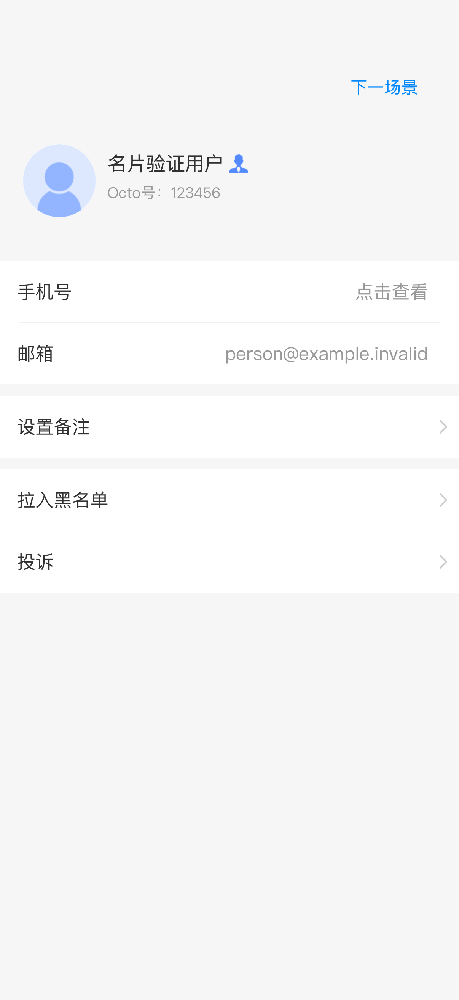
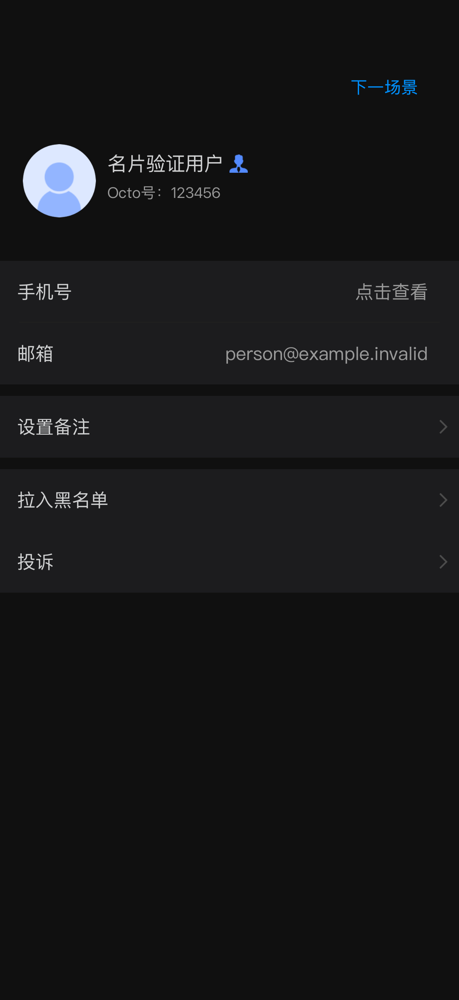

# PR #108 device validation

Date: 2026-10-12. Code tested: `82c3707f` (includes the author's `9e502985`
country-code fix and the contact-review corrections).

## Results

- Full application builds for both iOS Simulator and ARM64 iOS succeeded with
  Xcode 26.6 and SDK 26.5.
- **15/15 native assertion cases passed on a connected iPhone 17 running iOS
  27.0.** [Raw results](results.json).
- The standalone validation app used the actual built `WuKongBase` framework,
  contact endpoint, model parser and controller. Profile data and remote config
  were offline fixtures. It had a separate bundle identifier and no production
  account or credentials.
- Simulator XCTest execution was blocked before the test cases started by an
  AsyncDisplayKit `+load` / UIKit initialization deadlock during XCTest injection.
  To obtain device evidence, the same 15 methods in `WKUserInfoContactTests.m`
  ran through a temporary native assertion adapter instead of XCTest injection.
  This is **not** a claim that the standard XCTest runner passed.
- The assertion adapter implements the XCTest assertion macros and expectation
  wait needed by these cases. It runs from a main-run-loop timer so configuration
  callbacks dispatched to the main queue can complete while waiting.

Coverage includes the 0/1/2 parser and display policy, self/peer/robot/flag
combinations, nil/null/wrong-type/empty contacts, legacy country codes, reveal
and conceal on the same VM, disappearance hook, separate live cards, row
separators, remark spacing and configuration callback ordering/failure.

## Actual device captures

These are unmodified UIKit view-hierarchy captures from the validation app,
using the production `WKUserInfoVC` and synthetic data. The blue next-scenario
button belongs to the test host. They validate the user-detail screen, not
`WKMeInfoVC` from PR #107.

| Scenario | Capture |
| --- | --- |
| Peer, phone hidden | [Normal](scenario-0.png) |
| Peer, phone revealed | [Revealed](scenario-1.png) |
| Dark appearance | [Dark](scenario-2.png) |
| English empty fields | [English](scenario-3.png) |
| Self, legacy +86 country code | [Self](scenario-4.png) |
| Cooling-off peer | [Cooling-off](scenario-5.png) |
| Deployment flag off | [Flag off](scenario-6.png) |
| Only email returned | [Single row](scenario-7.png) |

## Boundaries

No live backend authorization or server rollout was tested. The disappearance
check invokes the controller hook on a retained VM; a full production
chat-navigation flow is not covered by the fixture app. The captures use the
connected iPhone's native width, not a 375pt/320pt device, and do not establish
long-email truncation or accessibility behavior. The clarified product rules in #103
and the PR's linked-task/sprint check remain separate from this code validation.

## Runtime configuration follow-up

The follow-up replaces the one-shot controller callback with lifetime KVO on
`profileContactInfoOn`. Both successful and failed refreshes assign this property,
so either can revoke an already-rendered card. Revocation clears phone reveal
state; a later re-enable starts concealed. The controller removes its observer
on deallocation and ignores duplicate flag values. The global blacklist action
also uses the existing weak VM reference to avoid retaining contact data through
its registered closure.

The full simulator application build passed. **16/16 native assertion cases
passed in a standalone iPhone 17 simulator app** using the updated production
framework and the same assertion adapter described above. [Raw follow-up results](runtime-config-results.json).
The additional case covers updates after the initial request, off/on transitions,
reveal reset, duplicate suppression and observer teardown. The original physical
iPhone was unavailable; this follow-up is simulator evidence, not a new device
or standard XCTest run. Earlier screenshots remain evidence for the unchanged
layout at the code revision stated above.
